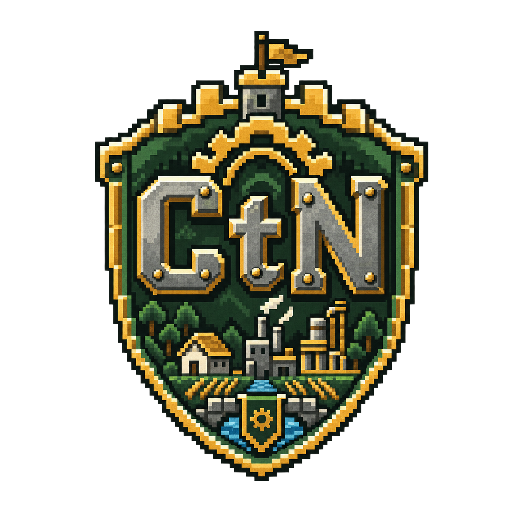

# Craft to Nation



**Craft to Nation** es un juego de supervivencia, construcción y estrategia en el que el jugador transforma un refugio en una nación industrial viva.

**Sitio web:** [crafttonation.netlify.app](https://crafttonation.netlify.app)

El proyecto está en etapa de pruebas de concepto. El desarrollo actual valida sus sistemas principales de forma incremental sobre un único proyecto de Godot, siguiendo el [GDD v3.59](Documento%20de%20Diseño%20de%20Juego%20%28GDD%29_%20Craft%20to%20Nation.md).

## Estado actual

- **Fase 0 — completada:** PoC 1 y 2 validan la lógica de recursos, demografía, nivel urbano, serialización y reglas de blueprints y zonas.
- **Fase 1 — verificada:** PoC 3 implementa el prototipo en primera persona sobre `GridMap`, minado y colocación, objetos multicelda y detección de edificios por volumen interno; reconoce habitaciones irregulares y de varios pisos, comprueba su acceso mediante pathfinding real e incorpora paneles de ventana de $1/20$ de espesor (`ventana` recta a media profundidad, `ventana_esquina` en L y `ventana_techo` al ras superior al mirar arriba/abajo).
- **Fase 2 — completa:** PoC 4 integra `Ciudad` y `Avatar` como autoload, zonificación y una cámara cenital navegable; PoC 8 añade colonos NPC con pathfinding propio; y el HUD incluye hotbar con iconos reales, miniaturas isométricas de edificios, tarjetas contextuales vectoriales y navegación numérica jerárquica.
- **Fase 3 — en progreso:** PoC 6 (mundo procedural, nivelación, puestos de recolección y cuerpos de agua) está completo con alcance reducido, y PoC 5 completó minerales, materiales y las cadenas de refinado. El mundo procedural finito de 200×200 celdas incluye dos montañas, seis minerales, yacimientos petrolíferos profundos en el subsuelo, mares, lagos, ríos, árboles talables y recursos agotables. Los cuatro puestos de recolección son edificios de bloques con puerta y baúl físico; `VentanaBaul` permite transferencias parciales entre el avatar y esos almacenes. La construcción manual y asistida consume materiales reales (`tierra_compactada`, `bloque_madera`, `bloque_piedra`, `estructura_hierro` y `vidrio`), devuelve recursos al minar o deconstruir, drena automáticamente el agua interior al terminar cada edificio e incorpora construcción fantasma pagada mediante colas temporizadas; los puestos solo se registran al terminar. Se incorpora la remodelación de edificaciones («desdeclaración» sin deconstrucción para edición libre mediante `Shift + B` apuntando a la puerta principal o desde `PanelEdificio`, con excepción limpia del núcleo urbano), buffers habitables de inmigración con apertura automática en 24h y toggle manual, reubicación cívica de residentes y gestión de sobrepoblación temporal. Se implementa el **Sistema de Moral Dinámica, Productividad Continua y Dinámicas Demográficas**: escala [0 a 100] con optimismo inicial en 75.0 e inercia a 50.0; tasa horaria $\Delta M$ afectada por superávit global (+0.4/h), escasez de recursos (comida hasta -3.0/h, energía hasta -1.5/h, insumos industriales hasta -0.4/h), diversidad de dieta (+0.5/h max con 6 categorías en el sub-almacén de comida), desgaste por colonos sin techo (-0.05/h por colono) y buffer móvil de peligrosidad de 168h (7 días); curva continua de productividad laboral $X = 0.5 \times 2^{(Y/50)}$ aplicada a recolección y refinado (50% en moral 0, 100% en moral 50, 200% en moral 100); inmigración continua post-núcleo urbano con desborde a "sin techo" (con tolerancia ampliada a 72h); éxodo pacífico de desempleados a los 10 días (240h); éxodo crítico en moral < 20 con fuga de cerebros jerárquica (`investigador` > `especialista` > `tecnico` > `militar` > `obrero`); y en interfaz, botón animado en barra superior con 4 estados emocionales (😡/🙁/😐/🙂) y modal explicativo compacto `VentanaMoral.gd` (migración bajo productividad laboral). Se implementa la **Sobreasignación e Integración de Iconografía Completa del HUD / UI**: catálogo centralizado de más de 95 íconos vectoriales SVG pixel-art en `godot/assets/icons/` administrado por `IconosHUD.gd`; barra superior con íconos de censo, moral, almacén, tendencia horaria de comida, rayo interactivo tri-color de energía con indicador dinámico en kW, nombre + ícono de la Era y número romano del Nivel (IDU I–IV) con ventana tooltip adherida a la esquina superior derecha; botones de construcción ampliados a 104×76 px con overlay de insignias en 3 esquinas y miniaturas 3D vivas; `VentanaAlmacen.gd` con desplegables jerárquicos A–Z de materias primas y sus refinados/derivados más botón de *"Expandir todo / Contraer todo"*; prioridades de obra con botones subir/bajar (`btn_subir.svg`/`btn_bajar.svg`) y transición automática de la ventana de obra al panel del edificio al completarse. La red aérea de canalizaciones (`Canalizaciones.gd`) implementa tuberías y acueductos con arquitectura modular de 4 piezas y cruces a desnivel en $Y_{suelo}+6$. Ya están operativas todas las industrias y refinerías (siderúrgica, tierras raras, aserradero, fábrica de bloques con `bloques_piedra`, **vidriera** con producción de `vidrio` a partir de `1 tierra + 1 carbón → 3 vidrio` y preferencia de uso en ventanas, carbonera, refinería petrolera `400/600`, productor de combustible, central de extracción de crudo y central termoeléctrica), el **Taller de Transporte (`taller_transporte`)** y el parque móvil de **6 unidades de acarreo** (con restricción vial estricta para camiones/trolebuses, modo de arrastre lento a `1.2 m/s` y uso exclusivo de `vidrio` en cabinas), el sistema de **reservas porcentuales de materia prima (`0%..50%`)** con botones subir/bajar, la formación de técnicos y especialistas, y el sistema de **Investigación Descentralizada en 2 Capas (Ciencia Teórica en Universidad + Aplicaciones Prácticas en edificios/Núcleo Urbano mediante el Investigador Itinerante)** junto con la **Evolución Orgánica de Eras (IDU 1–4) y la Balanza Tripartita (`Dieselpunk / Cyberpunk / Solarpunk`)**. Se implementa además la **Centralización de Variables de Configuración (`ajustes.gd`) y Textos UI con Reactividad (`strings.gd`)** con soporte multilingüe.
- **Fases 4–7 — planeadas:** cámara dual y tropas, logística y puentes, combate e IA, y multijugador LAN.
- **Visión a largo plazo:** eras tecnológicas posteriores al nivel urbano actual y un servidor MMO por planetas, todavía sin PoC ni fase asignada.

El proyecto Godot cuenta actualmente con **28 escenas** `*Test.tscn` ejecutables en suite automatizada: validación de blueprints y construcción, ciudad, zonificación, mundo, árboles, nivelación, recolección, plantillas y miniaturas de puestos, economía, extracción, colonos, rutas, vías, minerales, translúcidos, puertas, canalizaciones, lámpara del jugador, HUD y energía.

## Ideas incorporadas al roadmap

- **Mundo procedural finito:** implementado como primer subproyecto de PoC 6.
- **Nivelación de terreno sobre relieve:** implementada y confirmada visualmente; los edificios con puerta toman como nivel el suelo natural frente a su puerta guía, permitiendo que edificios enfrentados compartan bloques de nivelación y despeje; los puestos periféricos se nivelan al punto más alto de su huella. La excavación produce materiales y el relleno los consume dentro de una cola temporizada.
- **Puestos de recolección y previsualización en el HUD:** minas (seis minerales por profundidad), caza y recolección, maderero y pesca y frutos del mar, colocables desde la cámara cenital con estadísticas en vivo. Son edificios de bloques con plantilla propia, y al colocarlos se previsualizan la plantilla fantasma, el despeje de puertas y ventanas y la nivelación del frente, igual que un edificio declarado. Producen recursos reales con trabajadores asignados, soportan retroceso de nivel según el rango mínimo empleado, y alimentan el almacén central con acarreadores que interactúan desde la celda de servicio frontal.
- **HUD por modos y responsividad:** barra superior responsiva adaptada a distintas resoluciones, con botón de Almacén compacto, cifras/tasas en vivo de Comida, Energía y Recurso Crítico, nombre e ícono de Era, e ícono en número romano del IDU (I–IV) con ventana tooltip desplegable en la esquina superior derecha; ventana de Almacén ordenada alfabéticamente con desplegables jerárquicos de materias primas/refinados y botón de expandir/contraer todo; ventana de Ocupaciones agrupada por categorías colapsables y ordenada por antigüedad; prioridades de construcción y reservas con botones subir/bajar; transición automática de ventana al terminar obras; diálogos y baúles interactivos cerrables con tecla `E` o `Escape`. En la cenital, el menú jerárquico admite navegación numérica, muestra miniaturas isométricas y sincroniza selección/rotación. En tarjetas contextuales de herramientas y colocación, las instrucciones se desglosan por línea con iconos vectoriales SVG (`click_izq.svg`, `click_der.svg`, `scroll.svg`) y doble clic `x2`. En primera persona, la hotbar usa iconos reales y tarjetas completas. Faltan batalla, escuadrón y salud.
- **Puertas, ventanas de $1/20$ y baúles interactivos:** las puertas se abren con `E` y reaccionan a los colonos; las ventanas se renderizan como paneles transparentes de $1/20$ de espesor (`ventana` recta a media profundidad, `ventana_esquina` en L y `ventana_techo` contra la cara superior al mirar arriba/abajo); `VentanaBaul` permite consultar y transferir cantidades parciales entre el inventario del avatar y un baúl físico, cerrándose también con `E`.
- **Bioma y vegetación:** implementadas las señales de fauna, frutales y árboles; el mundo genera árboles procedurales talables y el jugador puede talarlos mediante acciones repetidas.
- **Catálogo de recursos, cadenas de producción, logística móvil e investigación en 2 capas:** minerales, materiales reales de construcción, nueve industrias (siderúrgica, tierras raras, aserradero, fábrica de bloques, vidriera, carbonera, refinería petrolera, productor de combustible y central termoeléctrica) con control individual de reservas porcentuales (`0%..50%`) en el almacén central, taller de transporte y parque móvil de 6 unidades de acarreo (con restricción vial y arrastre lento), fluidos (agua, crudo y combustible), red de energía por influencia y vías con déficit, y formación e investigación descentralizada en 2 capas (Universidad + Aplicaciones con Investigador Itinerante) conectadas al IDU y a la balanza de doctrinas (`Dieselpunk / Cyberpunk / Solarpunk`).
- **Cuerpos de agua:** implementados (mares, lagos y ríos con corriente y cascadas, agua transparente y no sólida, natación con oxígeno, escurrimiento con niveles y secado). Cauces sinuosos y un nivel de mar que dependa del tipo de mundo siguen pendientes.
- **Puentes:** previstos como PoC 10 en la Fase 5, reutilizando el trazado de las redes de transporte.
- **Tallado cosmético por celda:** previsto como pulido visual, sin fase propia.
- **Túneles y cavernas:** previstos a futuro; dependen de la generación de terreno y de las mecánicas de combate.

El contexto y la ubicación de estas ideas se conservan en [docs/ideas-backlog.md](docs/ideas-backlog.md).

## Estructura

```text
PoC_1/     Motor lógico de recursos y demografía
PoC_2/     Serialización y validación de blueprints
PoC_3/     Documento técnico del prototipo visual
PoC_4/     Documentos técnicos de ciudad y zonificación
PoC_5/     Catálogo de recursos y cadenas de producción
PoC_6/     Documentos técnicos del mundo y recolección
PoC_8/     Pathfinding a pie y colonos NPC
godot/     Proyecto compartido desde PoC 3
docs/      Especificaciones, planes e ideas del backlog
```

## Ejecutar el prototipo

1. Instala Godot 4.7.
2. Importa `godot/project.godot` (proyecto Godot compartido, usado por PoC_3 en adelante).
3. Ejecuta el proyecto con **F5**.

Para correr las pruebas de Godot, abre cada escena y usa **F6**:

- `godot/scenes/Test.tscn`
- `godot/scenes/BlueprintsTest.tscn`
- `godot/scenes/ConstruccionTest.tscn`
- `godot/scenes/CiudadTest.tscn`
- `godot/scenes/ZonificacionTest.tscn`
- `godot/scenes/GeneradorMundoTest.tscn`
- `godot/scenes/GeneradorArbolTest.tscn`
- `godot/scenes/NiveladorTerrenoTest.tscn`
- `godot/scenes/RecoleccionTest.tscn`
- `godot/scenes/CadenaMineralesTest.tscn`
- `godot/scenes/TranslucidosRendererTest.tscn`
- `godot/scenes/PlayerNatacionTest.tscn`
- `godot/scenes/PlayerOxigenoTest.tscn`
- `godot/scenes/BuscadorRutasTest.tscn`
- `godot/scenes/ColonosTest.tscn`
- `godot/scenes/FantasmasPermeablesTest.tscn`
- `godot/scenes/EconomiaTest.tscn`
- `godot/scenes/ExtraccionTest.tscn`
- `godot/scenes/ViasTest.tscn`
- `godot/scenes/PlantillasPuestoTest.tscn`
- `godot/scenes/PuertasTest.tscn`
- `godot/scenes/PuestosPrevisualizacionTest.tscn`
- `godot/scenes/CamaraCenitalModosTest.tscn`
- `godot/scenes/HUDTest.tscn`
- `godot/scenes/MiniaturaRendererTest.tscn`
- `godot/scenes/ObrasTest.tscn`
- `godot/scenes/CanalizacionesTest.tscn`
- `godot/scenes/PlayerLamparaTest.tscn`

En Windows también puedes ejecutar las 28 escenas en modo headless. El script falla si Godot devuelve un código distinto de cero, registra `ERROR:`/`SCRIPT ERROR` o una escena no llega a su mensaje final:

```powershell
.\tools\run-godot-tests.ps1 -GodotPath "C:\ruta\a\godot.exe"
```

## Contribuir

Consulta [CONTRIBUTING.md](CONTRIBUTING.md) antes de enviar cambios. Se aceptan aportes humanos o asistidos por IA siempre que quien los envía los haya revisado y pueda responder por ellos.

## Licencias

- El código fuente se distribuye bajo la [licencia MIT](LICENSE).
- La documentación y los recursos originales se distribuyen bajo [CC BY 4.0](LICENSE-CONTENT.md).
- El nombre y los logotipos de Craft to Nation no quedan licenciados para identificar proyectos derivados.
