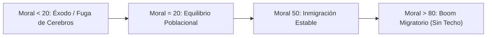

# Especificación de Diseño: Sistema de Moral y Dinámica Poblacional (GDD v3.56)

**Fecha:** 2026-10-15  
**Autor:** Daniel Peraza / Antigravity  
**Estado:** Propuesta de Diseño  
**Área:** Simulación Social, Economía y Demografía (`Ciudad.gd`, `Economia.gd`, `BarraSuperior.gd`, `VentanaMoral.gd`)

---

## 1. Visión General y Objetivos

El sistema de **Moral** introduce un indicador psicológico y social global ($0$ a $100$) que refleja la satisfacción, seguridad y prosperidad de los colonos en *Craft to Nation*. 

La moral deja de ser un número estático y pasa a ser un **sistema dinámico continuo**:
1. **No cambia instantáneamente:** Posee inercia temporal gobernada por una tasa de cambio horario ($\Delta M / \Delta t$) impulsada por la economía, la vivienda, la alimentación y la seguridad.
2. **Impacta directamente en la productividad:** La moral modula el rendimiento de obreros, técnicos y recolectores entre el $50\%$ y el $200\%$.
3. **Gobierna la migración real:** Determina la velocidad de llegada de nuevos colonos (generando sobrepoblación si no hay viviendas planificadas) o el éxodo de ciudadanos críticos si la moral cae por debajo de $20$.
4. **Desempleo y desamparo con límites temporales:** Los desempleados emigran tras $10$ días sin oficio; los ciudadanos sin techo toleran hasta $72$ horas antes de abandonar el asentamiento, desgastando la moral de la ciudad mientras sigan en la calle.
5. **Preparación para peligrosidad:** Un buffer móvil de $7$ días ($168$ horas de juego) listo para cuantificar el impacto moral de bajas, heridos y saqueos en cuanto se incorporen las amenazas.

---

## 2. Escala, Estado Inicial y Visualización HUD

### 2.1 Escala Numérica
* **Rango:** $[0.0, 100.0]$.
* **Punto de Neutralidad:** $50.0$.
* **Punto de Partida:**
  * Al iniciar el asentamiento / fundar el núcleo: **$75.0$** (Bono de optimismo inicial de los pioneros).
  * En ausencia de perturbaciones, la moral tiende gradualmente hacia el equilibrio ($50.0$).

### 2.2 Representación en la Barra Superior
En `BarraSuperior.gd`, el label plano actual de moral se convierte en un botón interactivo con icono de estado anímico según umbrales:
* **🙂 Feliz (Verde/Oro):** $\text{Moral} > 65.0$.
* **😐 Neutra (Blanco/Gris):** $35.0 \le \text{Moral} \le 65.0$.
* **🙁 Triste (Naranja):** $20.0 \le \text{Moral} < 35.0$.
* **😡 Enojado / Crisis Crítica (Rojo):** $\text{Moral} < 20.0$ (umbral donde se desata el éxodo migratorio).

Al hacer clic en el botón de moral, se abre la nueva ventana modal **`VentanaMoral.gd`** (estilo `TemaHUD`), mostrando:
* Valor exacto de moral y tendencia horaria (ej: `72.4% (+0.8/h)`).
* Icono de estado anímico y advertencias si está en zona de crisis (< 20).
* Desglose de factores contribuyentes (abundancia de recursos, variedad de dieta, penalización por sin techo, estabilidad de empleo, peligrosidad).
* Efectos activos en la ciudad (multiplicador de producción actual y tasa de inmigración/emigración).

---

## 3. Dinámica Temporal de la Moral (Tasa de Cambio Horaria)

En cada tick de simulación (1 hora de juego), la moral se actualiza según:
$$M_{t+1} = \text{clamp}(M_t + \Delta M, 0.0, 100.0)$$

Donde $\Delta M$ es la suma de los siguientes términos:

### 3.1 Tendencia al Equilibrio (Inercia Natural)
$$\Delta M_{\text{inercia}} = (50.0 - M_t) \times 0.02$$
*(Si no hay presiones externas, la moral regresa suavemente al centro).*

### 3.2 Impacto de Recursos y Abundancia
1. **Bonificación de Abundancia General:**
   * Si todos los recursos con consumo activo tienen tasa neta positiva ($\text{tasa\_neta\_promedio} > 0$): **$+0.4/\text{h}$**.
2. **Escasez y Déficit Ponderado por Gravedad:**
   * **Comida:**
     * Tasa neta negativa (consumo > producción) con stock $>0$: **$-0.6/\text{h}$**.
     * Stock agotado ($=0$ o hambruna activa): **$-3.0/\text{h}$** (penalización severa).
   * **Energía (si la ciudad tiene demanda industrial activa):**
     * Déficit de cobertura ($<100\%$): hasta **$-1.5/\text{h}$** según el factor de déficit.
   * **Recursos Industriales y Materiales (hierro, madera, piedra, carbón, etc.):**
     * Tasa neta negativa en recurso con demanda de construcción/refinado: **$-0.1/\text{h}$** por recurso.
     * Stock agotado de recurso demandado: **$-0.4/\text{h}$** por recurso.

### 3.3 Variedad de Alimentos (Acelerador de Tasa)
El bono existente de diversidad de comida ($0$ a $6$ categorías activas) no es un techo rígido, sino un acelerador del bienestar:
$$\Delta M_{\text{dieta}} = \left(\frac{\text{activas}}{6}\right) \times 0.5/\text{h}$$
*(Una dieta completa de 6 grupos aporta $+0.5/\text{h}$ constante a la moral).*

### 3.4 Penalización por Ciudadanos Sin Techo
Cada colono sin vivienda degrada la moral de toda la comunidad en cada hora que pasa a la intemperie:
$$\Delta M_{\text{sin\_techo}} = -0.05 \times \text{sin\_techo}/\text{h}$$
*(Ejemplo: 10 ciudadanos sin techo generan un desgaste de $-0.5/\text{h}$).*

### 3.5 Peligrosidad (Buffer Móvil de 7 días / 168 horas)
Estructura preventiva en `Ciudad.gd`:
$$\Delta M_{\text{peligro}} = - (0.5 \times \text{bajas}_{7\text{d}} + 0.1 \times \text{heridos}_{7\text{d}} + 0.005 \times \text{robos}_{7\text{d}})$$
*(Inicia en $0$ hasta que existan NPCs hostiles en Fase 6).*

---

## 4. Efectos de la Moral en el Juego

### 4.1 Productividad Laboral (Rendimiento)
La moral modula directamente la velocidad de producción y extracción en `Economia.gd` mediante una curva continua no escalonada:

$$X = 0.5 \times 2^{\left(\frac{Y}{50}\right)}$$

Donde:
* **$Y$:** Nivel actual de moral en $[0.0, 100.0]$.
* **$X$:** Multiplicador de productividad laboral aplicado a la producción de puestos y refinerías ($0.5\times$ en 0, $1.0\times$ en 50, $2.0\times$ en 100).

> Nota (2026-10-15): la fórmula original propuesta ($0.5 + 0.5 \cdot 1.33256^{u} \cdot 1.25052^{u^2}$) daba $1.0\times$ en moral 0 y $2.67\times$ en 100; se acordó con el usuario la exponencial pura que pasa exactamente por $0.5 / 1.0 / 2.0$.

En GDScript:
```gdscript
static func calcular_multiplicador_productividad(moral: float) -> float:
	return 0.5 * pow(2.0, clampf(moral, 0.0, 100.0) / 50.0)
```

### 4.2 Dinámica Migratoria (El Umbral Crítico de 20)
El umbral de equilibrio migratorio es **Moral = 20**:



1. **Si $\text{Moral} > 20.0$ (Inmigración Positiva):**
   * Tras fundar el núcleo, los colonos llegan a la ciudad con una frecuencia dependiente de la moral:
     * A moral $50$, llega $1$ colono cada $24$ horas.
     * A moral $90$, llega $1$ colono cada $6$ a $8$ horas.
   * **Sobrepoblación libre:** Si la capacidad residencial está colmada, los colonos **no se rechazan**; entran como `desempleado` en la condición de `sin_techo`.
2. **Si $\text{Moral} < 20.0$ (Éxodo / Emigración):**
   * La desesperanza provoca la huida de habitantes.
   * **Jerarquía de fuga de cerebros (vida real):**
     $$\text{investigador} \to \text{especialista} \to \text{tecnico} \to \text{militar} \to \text{obrero}$$
   * La ciudad pierde a sus ciudadanos más capacitados primero, reflejando el colapso social si no se atiende la crisis.

### 4.3 Límites Temporales: Desempleo y Sin Techo
1. **Éxodo por Desempleo Prolongado:**
   * Cada desempleado acumula horas de desempleo (`horas_desempleo`).
   * Si un colono permanece desempleado más de **$10$ días de juego ($240$ horas)**, hace las maletas y emigra de la ciudad en busca de oportunidades.
2. **Tolerancia de los Sin Techo:**
   * La tolerancia se amplía de $24$ horas a **$72$ horas ($3$ días de juego)**.
   * Si tras $72$ horas no se han construido camas para ellos, el colono sin techo abandona la ciudad y se registra el desahucio definitivo.

---

## 5. Arquitectura Técnica de Implementación

### Archivos Afectados
* `godot/scripts/Ciudad.gd`:
  * Variables `moral`, `tasa_cambio_moral`, buffer circular de peligrosidad (`registro_seguridad_168h`).
  * Contadores de desempleo y tolerancia de 72h para `sin_techo`.
  * Lógica de inmigración continua y jerarquía de éxodo en `_migrar()`.
* `godot/scripts/Economia.gd`:
  * Integración de `factor_moral_de()` multiplicando la productividad en `recalcular_tasas()` y `_refinar()`.
* `godot/scripts/BarraSuperior.gd`:
  * Sustitución del texto plano de moral por botón con icono de emoji/estado (`🙂`, `😐`, `🙁`).
* `godot/scripts/VentanaMoral.gd` *(Nuevo)*:
  * Modal informativo con desglose analítico de factores y tendencias.
* `godot/scripts/HUD.gd`:
  * Conexión de señal y apertura de `VentanaMoral`.
* `godot/scripts/CiudadTest.gd`, `godot/scripts/EconomiaTest.gd`, `godot/scripts/HUDTest.gd`:
  * Pruebas automatizadas de la curva de moral, multiplicadores, colas de desempleo y visualización.
